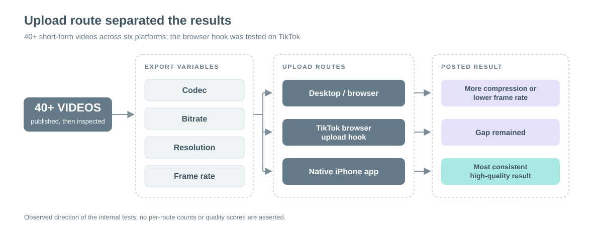
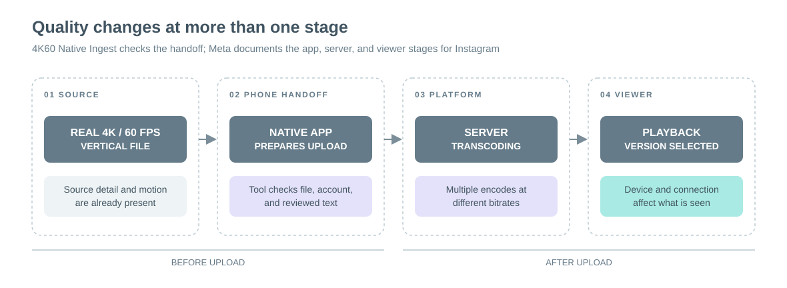
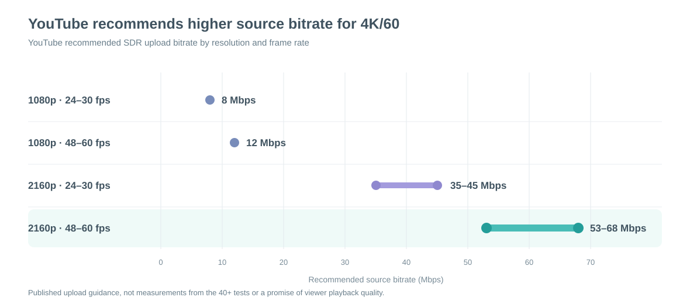

# 4K60 Native Ingest

*Why my video uploader uses an iPhone*

*Original tests: September 2026 · Note revised: 22 October 2026*

I edit videos on Windows. I wanted the version people watched to keep the detail and motion in the file I exported.

In my September comparison of more than 40 short-form videos, I varied codecs, bitrates, resolutions, frame rates, and upload routes across YouTube, TikTok, Instagram, Threads, Facebook, and X. The most consistent result for my footage was a genuine vertical 4K/60 fps export uploaded through the native iPhone app.

That finding changed what I built. Instead of spending more time trying to make browser uploads behave like phone uploads, I built a Windows-to-iPhone workflow around the route that worked in those tests.

## Compare the posted video

*The structure of the comparison. This is a qualitative summary; it does not supply per-route sample counts or quality scores.*

A file marked 60 fps is not proof that the platform serves it at 60 fps. I checked processed playback, rather than stopping at a successful upload or a good-looking preview.

The TikTok browser uploads I inspected were served at 30 fps, including one from a 1080p/60 source. A separate iPhone upload had a 1080p version near 60 fps. That is a result from the inspected uploads, not a promise about every account, video, or future app version.

## The browser extension did not solve it

I inspected a supplied extension called **60FPS Upload Manager v5.5.2**. Its basic mode changed temporary video URLs and draft or editing fields inside TikTok's normal uploader. Its other modes sent files to an external service.

I rebuilt the local basic mode. The page could report that the hook was active, but the posted videos I checked still did not reproduce the iPhone result. A green check in an extension was evidence that the extension ran, not that the platform delivered 60 fps.

I did not copy the external-service modes. I wanted a route I could run locally.

## Build around the successful handoff

*The upload crosses several processing stages. My comparison observed the result of the whole route; it did not isolate how much each stage changed the picture.*

**4K60 Native Ingest** was the initial Windows-and-iPhone workflow. The current [Auto iPhone Uploader](https://github.com/thedevmark/auto-iphone-uploader) carries that work forward: prepare the video and text on the PC, then use the real social apps on the connected phone.

That introduces a different engineering problem. The app must keep track of the exact file, intended account, reviewed text, phone connection, and result of the final tap. If a tap times out, retrying immediately could post the same video twice. Recovery has to check what happened before another submission.

The [current launch checklist](https://github.com/thedevmark/auto-iphone-uploader/blob/main/docs/launch-checklist.md) separates working phone flows from unfinished scheduling, receipt, and device-coverage work. The route comparison alone does not establish that every part of the uploader is finished.

## Export settings still have a job

*Reference export guidance from YouTube, not measurements from my upload comparison and not delivered playback bitrates.*

Use real source detail and motion. Exporting a 30 fps clip as 60 fps does not recreate missing motion, and a bigger file does not guarantee a better platform encode.

For the files in these tests, the useful sequence was: export a clean vertical master, confirm the exact file on the phone, upload through the native app, wait for processing, and inspect the published result on another device.

The limitation is important: this is a practical route choice from my own footage, not a controlled platform benchmark. The result gave me a reason to build the uploader. It did not give me control over what a platform ultimately serves.

Reference: [YouTube's recommended upload settings](https://support.google.com/youtube/answer/1722171) and [processing guidance](https://support.google.com/youtube/answer/71674).

[Auto iPhone Uploader](https://github.com/thedevmark/auto-iphone-uploader) · [All build notes](../)
