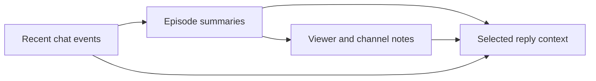

# Giving a Twitch bot useful memory

*ForgetMeNot · Implementation note · 22 October 2026*

I wanted a chat bot that could remember a regular and pick up a running joke on the next stream. Sending an ever-growing transcript with every reply would be a poor way to do that.

[ForgetMeNot](https://github.com/thedevmark/forgetmenot) keeps memory in a local SQLite database. At reply time it selects a small amount of relevant context. The size of that reply context does not have to follow the size of the archive.

## Keep different kinds of memory

The implementation separates incoming events, episode summaries, and longer-lived notes about viewers or the channel.

Raw events are stored temporarily. The compaction loop includes a rule to prune events older than 24 hours; summaries and notes can remain longer. That is temporary local retention, not “no chat logs.” Pruning also depends on the runtime doing its maintenance work.

The summaries give extraction a smaller source to work from. They also introduce a cost: a summary can lose a detail or get something wrong before a note is ever written.

## Choose context for the current person

When someone speaks, the relevant memory is usually a small set of notes about that viewer and the channel. The implementation selects active notes with SQL, using confidence and recency in the ordering.

That was enough to justify a direct query rather than adding a vector-search service. It is a choice for this candidate set, not a rule that every memory system should use the same retrieval method.

The person's own recent messages are selected separately from the room's recent chat. Someone may split a question across several lines before mentioning the bot. In a busy room, trimming the channel buffer should not remove the start of that person's question.

## Fit the reply budget

The prompt assembler puts slower-changing context before the parts that change with each message. It estimates the input size and trims lower-priority sections when necessary.

The retained note IDs and trim decisions are recorded for inspection. That makes it possible to ask what the bot actually saw when a reply went wrong, instead of blaming “memory” as one undifferentiated feature.

The estimate is not an exact provider token count. The final request and provider usage still matter when measuring cost.

## Remember where a note came from

The note schema distinguishes what someone said about themselves, what someone else reported, and what the system inferred. Those categories should not be treated as equally certain.

Duplicate handling and source labels help, but they do not make an extracted note true. Recency can also put a recent, weak note ahead of an older useful one. Correction, stale-note handling, and evaluation are ongoing parts of the problem.

## Local storage is one boundary

Keeping the database on the streamer's computer does not mean every model request stays on that computer. The reply engine supports hosted and local models; the selected provider and configured memory operations determine where processing occurs. The [project README](https://github.com/thedevmark/forgetmenot#how-it-works) covers the available setup.

A model reply also does not get to perform a moderation action merely by containing a command. Proposed actions pass through a separate policy layer. Memory and chat remain input to that layer, not permission to bypass it.

The useful result is continuity with a manageable working set. The remaining work is to measure when that context helps, when it misleads the reply, and how quickly a bad memory can be corrected.

Implementation: [compaction](https://github.com/thedevmark/forgetmenot/blob/main/src/memory/compaction.ts), [context selection](https://github.com/thedevmark/forgetmenot/blob/main/src/memory/context.ts), [note extraction](https://github.com/thedevmark/forgetmenot/blob/main/src/memory/notes.ts), and [prompt budget](https://github.com/thedevmark/forgetmenot/blob/main/src/reply/budget.ts).

[ForgetMeNot](https://github.com/thedevmark/forgetmenot) · [All build notes](../)
