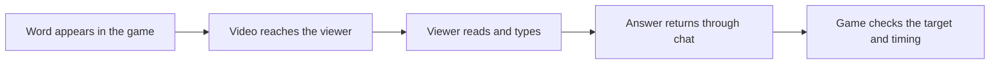

# Making a chat game work over stream delay

*Chat vs. Meteors · Build note · 22 October 2026*

[Chat vs. Meteors](https://meteor.deutschmark.online) is a game viewers play by typing words in chat. A word appears on a falling meteor. Someone types it, a turret fires, and the planet gets another chance.

That sounds like a typing-speed problem. The stream makes it a timing problem first.

## Three clocks for one answer

The game knows when a word appears. A viewer sees that word later, through the video stream. Their answer takes another trip through chat before the game receives it. A desktop viewer and a phone viewer can be responding to different moments in the same round.

If I accept answers only while a meteor exists on the host's screen, a person can type the right word while it is still visible on their screen and get treated as wrong. But giving every meteor enough time for the slowest viewer makes the game drag for everyone else.

*The game can observe the start and the received answer. It cannot directly observe when the viewer saw the word or began typing.*

## Keep the room moving

The automatic timing system uses actual correct answers to learn the room's pace. The quick end of the responding crowd sets the main allowance. Slower replies can add a limited amount to that shared allowance; they do not stretch every target indefinitely.

The allowance changes gradually. Meteors already in flight do not suddenly accelerate or slow down because a new answer arrived.

This is deliberately an estimate of observed responses. It is not a measurement of someone's internet ping or typing speed. Reading, typing, video delay, and chat delivery are mixed together.

## Give delayed players another way to take part

A single shared allowance is not enough. The game also learns response windows for individual players on ordinary words, accounting for word length and known chat transport lag.

Some ordinary targets can be shared: several distinct defenders each get a physical hit. Those targets can allow more time while other targets keep the faster players occupied. The scheduler limits how much shared work it adds and avoids leaving one long shared target hanging at the end of a wave.

Resolved targets also stay recognizable for a bounded late-answer window. For an ordinary word, an exact late reply inside an established personal response window can earn no points and lose no points. That prevents a delayed view from automatically becoming a penalty, without awarding another full hit to an already finished target. Other late answers still follow the game's normal scoring rules.

That distinction matters. Recognizing a valid delayed response does not mean giving unlimited time or unlimited duplicate credit.

## Protect the timing evidence

The calibration should reflect people playing the game. Bot messages, the channel owner's immediate view, practice players, duplicate observations, and unsuitable target types do not get to manufacture confidence.

Old samples expire during active measurement. Pauses do not use up that measurement time. A player who answered earlier in the stream should not leave a permanent timing assumption behind after they stop playing.

The difficulty system also separates a close race from a reply that arrived far behind. A very late answer is not evidence that the room had spare capacity for harder play.

## What I check

The timing code has separate regression cases for mixed response speeds, sample expiry, shared targets, late-answer scoring, and the different timing rules in Local Play. These checks let me change one timing rule without silently changing the others.

They cannot tell me whether a real room finds the game fair or fun. That still needs people playing, especially a mix of desktop and phone viewers. I keep those two questions separate: whether the rule behaves as intended, and whether it produces a round people want to play again.

[Play Chat vs. Meteors](https://meteor.deutschmark.online) · [All build notes](../)
