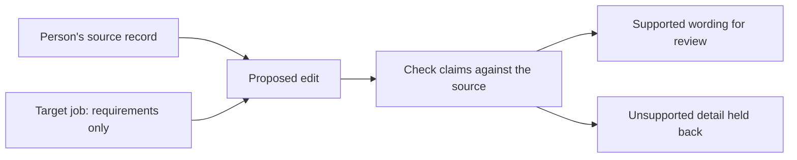

# Keeping AI resume edits tied to real experience

*Pathos · Build note · 22 October 2026*

[Pathos](https://yourpathos.app) connects a person's job search: roles, resumes, applications, and the next thing they need to do. The resume work has a basic constraint. Improving the wording must not invent the person.

A fluent sentence can still be false. A neatly structured import can still contain a company or skill that was never in the document. Asking a model to stay factual is only one part of the implementation.

## Importing a resume is already a truth problem

The first boundary comes before rewriting. When a model turns a document into structured fields, a valid response shape does not prove that the field values came from the source.

Pathos checks extracted resume strings against the document text after normalizing punctuation and whitespace. Unsupported imported values are omitted. If the remaining result has no useful resume structure, the import is rejected.

This is a stricter job than deciding whether a rewrite sounds reasonable. At this stage, the model is supposed to extract the record, not improve it.

## A job posting is not candidate evidence

The target role tells the optimizer what the employer asks for. It does not establish that the candidate has done those things.

For example, a posting that asks for team leadership cannot justify adding “managed a team of five” to a resume that never says that. That is an illustrative failure case, not an example of a real user's resume.

The editing path can propose clearer wording and a different emphasis. Checks around that proposal look for unsupported numbers, named tools, acronyms, and result claims. The person's source record remains the reference when a proposed edit cannot be supported.

The checks are useful, but they are not a proof that a model understands someone's career. They can miss meaning or reject wording that a person could explain. The review step still matters.

## The result page makes claims too

It is possible to keep the resume text factual and then mislead the person in the explanation.

A “skill found in your record” label needs evidence in that record. A missing requirement should remain a gap. Related business language must not accidentally become evidence of a programming language or a new qualification.

Pathos has regression cases for these distinctions. They include an absent skill staying absent and “go-to-market” wording not establishing the Go programming language.

The result also has to describe the final document. If cleanup restores source wording after a proposed edit fails a check, the explanation cannot keep celebrating the rejected version.

## Keep assistance separate from the person's decision

The same boundary carries into the [Chrome extension](https://chromewebstore.google.com/detail/ecniiinpnbhcjicagdhipdogcajohdip). It can prepare supported application fields, attach a reviewed resume, and draft answers from the candidate's information. Uncertain or sensitive fields stay for review. The candidate submits.

A fit score is another limited aid. It can help inspect the relationship between a posting and a resume. It cannot establish how an employer's private screening system will behave or predict a hiring decision.

This constraint adds work: source checks, rejected proposals, corrections, and explanations that must stay in agreement. I keep it because the person has to stand behind the application after the software is finished.

[Pathos](https://yourpathos.app) · [Pathos Chrome extension](https://chromewebstore.google.com/detail/ecniiinpnbhcjicagdhipdogcajohdip) · [All build notes](../)
