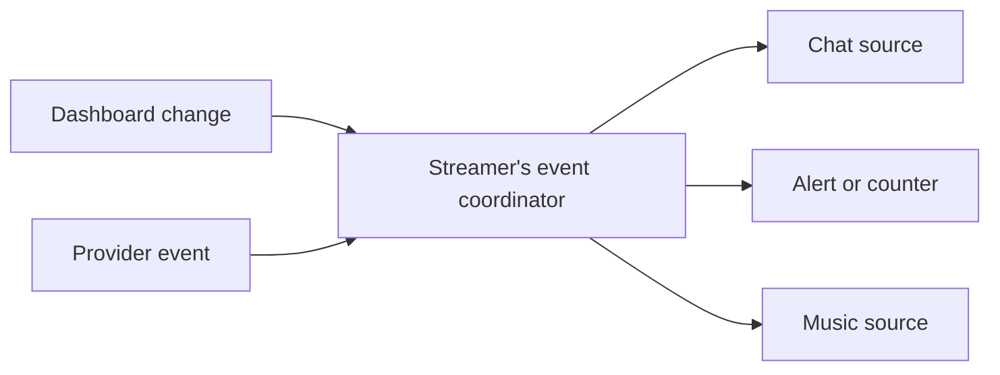

# Keeping stream overlays in sync

*Streamer Online · Implementation note · 22 October 2026*

A streamer can have several browser sources open in OBS: chat, an alert, a counter, a music display, and different scenes that reuse them. A setting changed in the dashboard should reach the right source without each window constantly asking the server what changed.

[Streamer Online](https://streamer.deutschmark.online) uses a shared event path for those updates. The useful question is how to keep the sources current while avoiding duplicate work.

## One place to distribute an update

Each streamer has a Durable Object that coordinates connected sources. The sources keep WebSocket connections to it. Dashboard changes and provider events enter the event path, then the coordinator sends updates to the sources that subscribe to them.

*The coordinator distributes updates. Each source still owns its own display.*

This gives a new widget an existing delivery path. It does not need its own independent loop to discover the same event.

## Send the changed state

A message that only says “something changed” can create another burst of requests: every connected source asks for the state it now needs.

Configuration updates can carry that state in the message. Sources apply it directly, with a read path available where a fallback is needed.

The recipient matters as much as the payload. Two widgets owned by the same streamer can have different settings. Updates for one widget token are filtered to that token, alongside checks for the source's subscribed modules and platform. Sharing a coordinator does not make all its sources interchangeable.

## Music needs a different route

A track's progress keeps moving even when no provider event arrives. Treating it like a discrete alert would leave a gap in the design.

The current implementation elects one connected music source to run a long poll against the Spotify worker. When that source finds a change, the coordinator distributes it to the others. Followers also make a bounded recovery read, so an open socket is not their only route back to current state. Without the shared socket, a source can poll independently.

The display advances progress locally between replies. Hidden or inactive sources pause their polling work.

This replaces an older design described in this note, where each browser polled Spotify directly. The current browser source reads the worker route. The distinction matters for both account handling and request accounting.

## Keep recovery in the design

Several windows being open is only the easy case. Sources disappear, reconnect, change scenes, or keep a socket that stops delivering useful updates.

The implementation needs both event delivery and ways to recover current state. It also needs to distinguish an update belonging to this widget from one belonging to a sibling widget.

Those are the behaviors worth checking before a request-count chart. A cheap source showing stale information is still broken.

## What this establishes

Sharing delivery and music polling removes specific classes of duplicate work. It does not establish a fixed monthly bill, a tested user ceiling, or a measured saving at a hypothetical audience size.

The implementation described here was checked against the October source. Its important boundaries are the per-streamer coordinator, per-widget delivery filters, the shared music poll, and the recovery reads.

[Streamer Online](https://streamer.deutschmark.online) · [All build notes](../)
